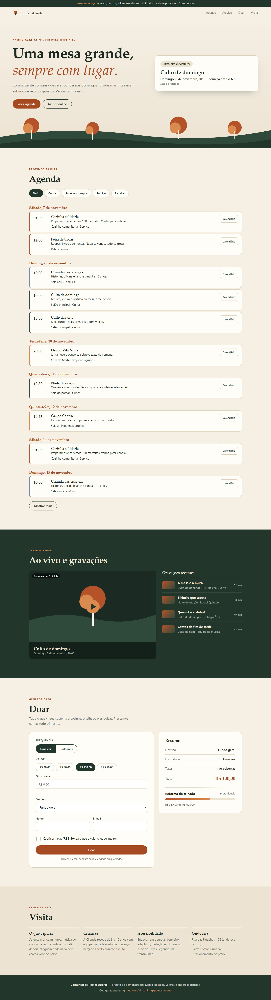

# Pomar Aberto — community church website (demo)

[](https://github.com/alissonlittig/pomar-aberto/actions/workflows/pages.yml)

Live: https://alissonlittig.github.io/pomar-aberto/

A single-page site for a **fictional** community church: a rolling 30-day agenda, a live-stream page that knows when a service is on air, and a donation flow with fee coverage. Everything (brand, people, amounts, address) is made up and flagged as a demo; no payment is processed and nothing is stored.

| Mobile (390px) | Desktop (1366px) |
|---|---|
|  |  |

## Features
- **Agenda** generated from weekly and "nth weekday of the month" rules, so it never goes stale. Category filters, "show more", and per-event `.ics` download.
- **Live status**: services are "on air" during their window; otherwise a countdown to the next one is shown (hero and player).
- **Giving**: one-time or monthly, preset or custom amount (pt-BR parsing), fund selection, optional processor-fee coverage (2.9% + R$ 0.30, demo numbers), validation with inline errors, a demo receipt code.
- Accessible by default: skip link, visible focus, labelled controls, `aria-live` summaries, reduced-motion support.

## Stack
Plain HTML, CSS and ES modules. No framework, no runtime dependencies. Logic lives in `src/logic.js` (pure functions) and is tested with Node's built-in test runner.

```
npm test        # 9 unit tests (recurrence, live status, ics, validation)
npm run build   # copies the static site to dist/
```

CI (`.github/workflows/pages.yml`) runs the tests, builds, and deploys `dist/` to GitHub Pages on every push to `main`.

## License
MIT. All content is fictional.
